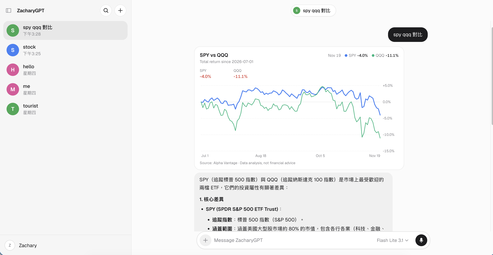

# ZacharyGPT

ZacharyGPT is an open-source **agentic AI chatbot**: a Next.js chat UI on top of a FastAPI + LangGraph agent that routes each message to a chat, research or coding branch. It answers over SSE with real-time streaming, searches your uploaded documents (RAG with reranking) and the web, remembers facts about you, and **draws interactive stock charts right in the chat**.



### Tech stack

| Layer | Technology | Location |
|---|---|---|
| UI | TypeScript + React 19 / Next.js 16 + Tailwind 4 | `frontend/` |
| API | Python + FastAPI (SSE streaming) | `backend/app/main.py`, `backend/app/api/` |
| Agent | Python + LangGraph + LangChain, Google Gemini | `backend/app/agents/` |
| Retrieval | ChromaDB + Gemini embeddings + FlashRank reranker | `backend/app/tools/rag.py` |
| Data | SQLite (chat history, memory, LangGraph checkpoints) | `backend/data/` |
| Evals & tracing | Offline RAG eval (matplotlib), LangSmith | `backend/evals/` |

---

## Highlights

* **Multi-agent graph:** an LLM router sends every message to a chat, research or coding branch, and each branch runs its own tool loop
* **Real-time streaming** over SSE, with stop/abort, and a typewriter effect that smooths out Gemini's large chunks
* **Document Q&A (RAG):** upload PDF, DOCX, TXT, MD, PY or CSV files; retrieval is two-stage (vector search, then a cross-encoder reranker), scoped to each conversation
* **Investment analysis with live charts:** `analyze_stock` / `compare_stocks` pull daily prices from Alpha Vantage, compute returns, volatility, drawdown, RSI and moving averages, and render an interactive chart in the chat
* **Measured, not guessed:** an offline RAG eval (10 documents, 68 questions) compares vector search with several rerankers. The first run found that the default reranker *hurts* (see [RAG Evaluation](#rag-evaluation))
* **LangSmith tracing:** every chat turn is one trace, grouped by conversation, with the retriever and rerank steps visible
* Web search (Tavily), long-term memory, calculator
* Conversation sidebar with rename, history reload (charts included), model picker, dark mode
* Tests on both sides (pytest with a fake agent, vitest + Testing Library), and the backend ships as a Docker image

---

## Agent Graph

Every user message goes through the router first, which sends it to one of three branches.
Each branch is an LLM ⇄ tools loop: the LLM keeps calling tools until it has enough to answer, then the turn ends.

```bash
                                 __start__
                                     │
                                     ▼
                              ┌─────────────┐
                              │   router    │   LLM picks: chat / research / coding
                              └──────┬──────┘
               ┌─────────────────────┼─────────────────────┐
             chat                 research               coding
               │                     │                     │
               ▼                     ▼                     ▼
     ┌──────────────────┐  ┌──────────────────┐  ┌──────────────────┐
     │     chatbot      │  │ research subgraph│  │ coding subgraph  │
     │        ⇅         │  │                  │  │                  │
     │      tools       │  │    researcher    │  │      coder       │
     │                  │  │        ⇅         │  │        ⇅         │
     │                  │  │      tools       │  │      tools       │
     └─────────┬────────┘  └─────────┬────────┘  └─────────┬────────┘
               └─────────────────────┼─────────────────────┘
                                     ▼
                                  __end__

# Tools available in each branch
#   chat     : calculator, search_uploaded_documents, remember_this, recall_memory, web_search,
#              analyze_stock, compare_stocks
#   research : web_search, search_uploaded_documents, analyze_stock, compare_stocks
#   coding   : search_uploaded_documents, web_search, calculator
```

| Part | File |
|---|---|
| Main graph (wiring) | `backend/app/agents/graph.py` |
| Shared state (`messages`, `route`) | `backend/app/agents/state.py` |
| Router | `backend/app/agents/router.py` |
| Research subgraph | `backend/app/agents/subgraphs/research/` |
| Coding subgraph | `backend/app/agents/subgraphs/coding/` |
| Tools | `backend/app/tools/` |

---

## Investment Analysis

Ask things like *"How is NVDA doing?"*, *"幫我分析 MSFT 最近的走勢"* or *"Compare AAPL, MSFT and GOOGL"*.

| Tool | What it does | Chart |
|---|---|---|
| `analyze_stock(symbol)` | ~100 trading days of daily prices: last close, 1-day / 1-month / period return, annualized volatility, max drawdown, RSI(14), SMA20/SMA50 trend | Price + SMA20/SMA50 + volume |
| `compare_stocks(symbols)` | 2–4 tickers aligned on common trading days, rebased to 0% | Total-return lines |

How the chart gets from a tool to the screen:

```text
tool returns (text, chart_spec)          LangChain "content_and_artifact"
   ├─ text        → the LLM              summarises and interprets the numbers
   └─ chart_spec  → ToolMessage.artifact
                     → chat_stream.py    emits SSE  {"chart": {...}}  before the answer tokens
                     → SQLite            saved with the assistant message (charts survive reload)
                     → stock-chart.tsx   interactive SVG: hover / ← → keys move the crosshair
```

- In the research subgraph the chart streams the same way (the tool's `ToolMessage` is emitted under the parent node name).
- Fundamentals (P/E, earnings) and news come from `web_search`: Alpha Vantage's `OVERVIEW` endpoint is premium.
- The free Alpha Vantage key allows ~25 requests/day, so responses are cached in-process for 15 minutes.
- The tools and both prompts state that this is data analysis, not financial advice.

---

## How RAG Works

RAG here is **agentic**: retrieval is a tool the LLM decides to call, not a step that runs on every message.

```text
1. Upload    file → text → chunks (900 chars, 150 overlap) → Gemini embeddings → Chroma
             each chunk tagged {thread_id, source}, so a conversation only searches its own files

2. Decide    the LLM (chat or research branch) sees the question and calls
             search_uploaded_documents(query=...), writing its own search query

3. Recall    Chroma vector search, filtered by thread_id → top 20 candidates  (RERANK_FETCH_K)

4. Rerank    FlashRank cross-encoder scores (query, chunk) pairs → keeps the best 4
             (falls back to vector order if the model can't load)

5. Answer    the 4 chunks come back as one ToolMessage:
               [Source 1: handbook.pdf | relevance 0.93]
               <chunk text> …
             the LLM reads them and writes the answer, citing the sources
```

| Step | Code |
|---|---|
| Upload + chunk + embed | `services/documents.py` → `tools/rag.py: add_document_to_rag` |
| Tool the LLM calls | `tools/retrieval.py: search_uploaded_documents` |
| Recall + rerank | `tools/rag.py: retrieve_docs(query, thread_id, k=4, use_rerank=True)` |
| Format for the LLM | `tools/rag.py: retrieve_from_rag` |

---

## RAG Evaluation

`backend/evals/rag/` checks whether retrieval puts the answer into the top 4 chunks the LLM sees. It compares plain vector search with vector search + rerankers, all reordering the same 20 candidates as `retrieve_docs()`.

- **Data:** 10 confusable documents for a fictional company (~71 chunks) and 68 English questions, each with an `evidence` string that must appear in a retrieved chunk.
- **Metrics:** Hit@k, MRR@4, latency → `results/` (JSON + charts).
- **Early finding:** on a smaller first version, the default reranker `ms-marco-MultiBERT-L-12` did *worse* than no reranking (Hit@4 69% vs 100%, +0.6 s per query). Re-run on the current corpus before changing `RERANK_*`.

```bash
cd backend
uv run --group eval python -m evals.rag.run                                   # needs a real GOOGLE_API_KEY
uv run --group eval python -m evals.rag.run --rerankers ms-marco-MiniLM-L-12-v2
```

Embeddings are cached in `evals/rag/.cache/` (separate from the app's `chroma_db/`), so re-runs cost no API calls. New evals go in `evals/<name>/`.

---

## LangSmith Tracing

Tracing is built in. Turn it on in `backend/.env`:

```env
LANGSMITH_TRACING=true
LANGSMITH_API_KEY=your_langsmith_api_key
LANGSMITH_PROJECT=zacharygpt
```

- **One trace per chat turn** (`chat_turn`), showing router → branch → LLM calls → tool calls.
- **Grouped by conversation:** `metadata.thread_id` makes each conversation a LangSmith *thread*. `metadata.model` and the `model:<name>` tag let you filter by model.
- **Retrieval is visible:** `retrieve_docs` shows up as a retriever run, with `rerank` nested inside it, so you can see which chunks the agent actually got.
- Evals trace to a separate project (`zacharygpt-evals`) only when run with `--trace`.

The backend logs `LangSmith tracing ON (project: …)` at startup when it is enabled.

---

## Getting Started

Make sure you have the following installed:

* Python 3.11 and [uv](https://docs.astral.sh/uv/) (`brew install uv`)
* Node.js 20+
* A Google API key (Gemini), a Tavily API key (web search) and an [Alpha Vantage](https://www.alphavantage.co/support/#api-key) key (stock data)
* Optional: a LangSmith API key (tracing), Docker

```bash
git clone https://github.com/<your-github-username>/ZacharyGPT.git
cd ZacharyGPT/backend
uv sync                       # creates .venv from uv.lock
```

### Environment variables

Create `backend/.env`:

```env
GOOGLE_API_KEY=your_google_api_key
GEMINI_MODEL=gemini-3.1-flash-lite

TAVILY_API_KEY=your_tavily_api_key
ALPHAVANTAGE_API_KEY=your_alphavantage_api_key

LANGSMITH_TRACING=false
LANGSMITH_ENDPOINT=https://api.smith.langchain.com
LANGSMITH_API_KEY=your_langsmith_api_key
LANGSMITH_PROJECT=zacharygpt

# Origins allowed to call the API (the Next.js frontend), comma-separated
FRONTEND_ORIGINS=http://localhost:3000,http://127.0.0.1:3000
```

### Run locally

```bash
cd backend && uv run python -m app.main      # API on http://127.0.0.1:8080 (docs at /docs)
cd frontend && npm install && npm run dev    # UI on http://localhost:3000
```

---

## API

Interactive docs: `http://127.0.0.1:8080/docs`

| Method | Path | Purpose |
|---|---|---|
| GET | `/api/health` | Check that the API is running |
| GET | `/api/conversations` | List conversations, newest first |
| GET | `/api/conversations/{thread_id}/messages` | A conversation's messages: `{"role", "content", "charts"}` |
| PATCH | `/api/conversations/{thread_id}` | Rename a conversation (`{"title": "..."}`) |
| POST | `/api/conversations/{thread_id}/documents` | Upload a document (multipart field `file`, max 20 MB) |
| POST | `/api/chat/stream` | Send `{"message", "thread_id", "model"}`; streams server-sent events |

`/api/chat/stream` emits one JSON object per `data:` line: `{"chart": {...}}` when a tool produced a chart, `{"token": "..."}` for answer text, `{"error": "..."}` on failure, then `{"done": true}`.

---

## Project Structure

```text
ZacharyGPT/
│
├── backend/                        # API + Agent (Python, managed by uv)
│   ├── app/
│   │   ├── main.py                 # create_app(): lifespan, CORS, routers
│   │   ├── core/config.py          # All settings from .env (models, CORS, paths, RAG, API keys, tracing)
│   │   ├── api/
│   │   │   ├── router.py           # Mounts every route module under /api
│   │   │   └── routes/             # health, conversations, documents, chat (SSE)
│   │   ├── schemas/                # Pydantic request/response models
│   │   ├── services/
│   │   │   ├── chat_stream.py      # Runs the agent → SSE (tokens + charts), trace metadata
│   │   │   └── documents.py        # Validates, saves and indexes uploads
│   │   ├── agents/
│   │   │   ├── graph.py            # Main graph: router -> chat / research / coding
│   │   │   ├── state.py            # Shared state (messages + route)
│   │   │   ├── router.py           # Task routing (LLM classifier)
│   │   │   └── subgraphs/
│   │   │       ├── research/       # Research agent: graph.py, state.py, nodes.py
│   │   │       └── coding/         # Coding agent: graph.py, state.py
│   │   ├── tools/
│   │   │   ├── __init__.py         # Collects the chat branch's tools
│   │   │   ├── context.py          # Reads the conversation id from the run config
│   │   │   ├── search.py           # Web search (Tavily)
│   │   │   ├── calculator.py       # Math
│   │   │   ├── retrieval.py        # Uploaded-document search tool
│   │   │   ├── memory.py           # Long-term memory (remember / recall)
│   │   │   ├── finance.py          # analyze_stock / compare_stocks (Alpha Vantage + indicators + chart spec)
│   │   │   └── rag.py              # Embeddings, ingestion, vector search + reranking
│   │   └── memory/database.py      # Conversations, messages (+charts), memories (SQLite)
│   │
│   ├── evals/
│   │   └── rag/                    # RAG retrieval eval
│   │       ├── corpus/             # 10 evaluation documents (fictional company wiki)
│   │       ├── questions.jsonl     # Questions + evidence strings
│   │       ├── run.py              # Runs vector vs rerankers, writes results/
│   │       ├── metrics.py          # Hit@k, MRR (unit-tested)
│   │       ├── plots.py            # matplotlib charts
│   │       └── results/            # summary.json, per_question.json, *.png
│   │
│   ├── tests/                      # pytest: API (fake agent), finance, eval metrics, integration
│   ├── pyproject.toml / uv.lock    # Dependencies (uv); `eval` group adds matplotlib
│   └── Dockerfile
│
├── frontend/                       # UI: Next.js 16 + TypeScript + React 19 + Tailwind 4
│   ├── app/                        # Layout, page, design tokens (globals.css)
│   ├── features/chat/
│   │   ├── use-chat.ts             # Chat state + actions (streaming, charts, uploads, history)
│   │   ├── chat-screen.tsx         # Composes the screen
│   │   └── components/             # Sidebar, header, messages, stock-chart, composer, …
│   ├── lib/                        # API client (ChatApi), SSE parser, chart spec + geometry, models
│   └── tests/                      # vitest, mirrors the source tree
│
├── docs/images/                    # README screenshots
├── .github/workflows/cicd.yaml     # AWS deploy workflow (manual only)
├── CLAUDE.md
└── README.md
```

---

## Docker Deployment

### 1. Build the Docker image

```bash
docker build -t zacharygpt backend
```

### 2. Run the Docker container

```bash
docker run -d \
  --name zacharygpt \
  --restart always \
  -p 8080:8080 \
  --env-file backend/.env \
  zacharygpt
```

The app will be available at:

```text
http://localhost:8080
```

---

## AWS CI/CD Deployment with GitHub Actions

This project can be deployed to AWS using:

* GitHub Actions
* Amazon ECR
* Amazon EC2
* Docker
* GitHub self-hosted runner

---

### 1. Create an IAM User

Create an IAM user for deployment and attach the following policies:

```text
AmazonEC2ContainerRegistryFullAccess
AmazonEC2FullAccess
```

You can also use a more restricted custom IAM policy for production.

---

### 2. Create an ECR Repository

Create an Amazon ECR repository.

Example full ECR image URI:

```text
315865595366.dkr.ecr.us-east-1.amazonaws.com/zacharygpt
```

For GitHub Secrets, only save the repository name:

```text
ECR_REPO=zacharygpt
```

Do not save the full ECR URI as `ECR_REPO`.

---

### 3. Create an EC2 Instance

Create an Ubuntu EC2 instance.

Recommended inbound security group rule:

```text
Type: Custom TCP
Port: 8080
Source: 0.0.0.0/0
```

---

### 4. Install Docker on EC2

Connect to your EC2 instance and run:

```bash
sudo apt-get update -y
sudo apt-get upgrade -y
```

Install Docker:

```bash
curl -fsSL https://get.docker.com -o get-docker.sh
sudo sh get-docker.sh
```

Add the Ubuntu user to the Docker group:

```bash
sudo usermod -aG docker ubuntu
newgrp docker
```

Check Docker:

```bash
docker --version
```

---

### 5. Configure EC2 as a GitHub Self-Hosted Runner

Go to your GitHub repository:

```text
Settings → Actions → Runners → New self-hosted runner
```

Select Linux and follow the commands shown by GitHub.

After setup, start the runner:

```bash
./run.sh
```

For production, you can configure the runner as a service:

```bash
sudo ./svc.sh install
sudo ./svc.sh start
```

---

## GitHub Secrets

Add the following secrets in your GitHub repository:

```text
AWS_ACCESS_KEY_ID
AWS_SECRET_ACCESS_KEY
AWS_DEFAULT_REGION
ECR_REPO

GOOGLE_API_KEY
GEMINI_MODEL
TAVILY_API_KEY
LANGSMITH_TRACING
LANGSMITH_ENDPOINT
LANGSMITH_API_KEY
LANGSMITH_PROJECT
```

Path:

```text
GitHub Repository → Settings → Secrets and variables → Actions → New repository secret
```

Example:

```text
AWS_DEFAULT_REGION=us-east-1
ECR_REPO=zacharygpt
GEMINI_MODEL=gemini-3.1-flash-lite
LANGSMITH_TRACING=true
LANGSMITH_ENDPOINT=https://api.smith.langchain.com
LANGSMITH_PROJECT=zacharygpt
```

---

## GitHub Actions Workflow

Create this file:

```text
.github/workflows/cicd.yaml
```

This workflow will:

1. Build your Docker image
2. Push the image to Amazon ECR
3. Pull the latest image on EC2
4. Stop the old container
5. Run the new container

---

## Run Tests

```bash
cd backend
uv run pytest                  # API, finance and eval-metric tests: fake agent + fake market data, no API calls
uv run pytest -m integration   # one real agent turn (needs a real GOOGLE_API_KEY)

cd ../frontend
npm test                       # useChat, SSE parser, chart geometry and StockChart (no server needed)
npm run typecheck && npm run lint
```

---

## Example Questions

```text
How is NVDA doing lately?
幫我分析一下 MSFT 最近的走勢
Compare AAPL, MSFT and GOOGL over the last few months.
Why did TSLA drop this month?            (research: chart + news)
Summarize the uploaded PDF.
Search the web for the latest AI agent news.
Calculate 125 * 48 / 6.
```

---

## Notes

* Do not commit your `.env` file to GitHub.
* Keep API keys inside GitHub Secrets for deployment.
* For production, avoid using `reload=True` in Uvicorn.
* Make sure port `8080` is open in your EC2 security group.
* Rotate any API keys that were accidentally exposed publicly.
* Stock analysis is for information only and is not financial advice.

---

## Contributing

Contributions are welcome: fork the repository, create a branch, make your changes, and open a pull request.

---

## License

This project is open source. Please check the repository license for usage terms.
